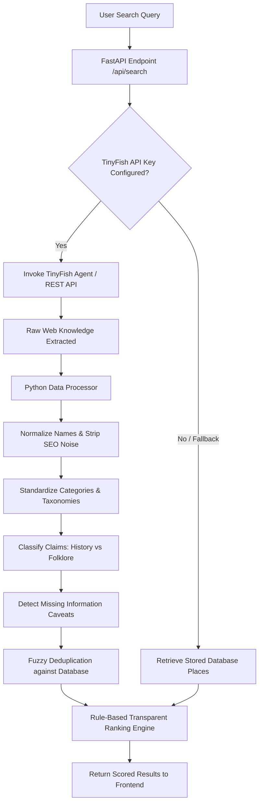

# 🧭 KHOJ — The Uncharted
> **Discover Places. Uncover Stories.**  
> *AZINHACK '26 Hackathon Official Submission*

[](https://www.python.org/)
[](https://fastapi.tiangolo.com/)
[](https://agent.tinyfish.ai/)
[](https://www.sqlite.org/)
[](#frontend-architecture)

---

## 1. Project Overview & The Problem

Travellers often find the same commercialized tourist spots through standard travel search engines and social media algorithms. Useful, authentic local knowledge—such as unlisted mountain trails, generational culinary heritage, artisan workshops, and sacred oral legends—is scattered across remote blogs, regional gazetteers, and personal accounts.

### What Travellers Need:
- **What is truly worth exploring?** Not just a list of popular monuments, but lesser-known spots with distinct cultural charm.
- **Why is a place interesting?** Authentic cultural context, historical significance, or living oral folklore.
- **What practical tips are available?** Timing, unpaved terrain warnings, bargaining rules, and cash considerations.
- **Where did the information come from?** Clear citation with source URLs, publication titles, and retrieval dates.
- **How recent and reliable is it?** Freshness indicators and explicit caveats for unverified opening hours or entry fees.

### The Solution: KHOJ
**KHOJ** is an ethical, source-aware local discovery platform built for travellers and residents. It synthesizes live web information using **TinyFish**, processes and normalizes data via an asynchronous **Python pipeline**, computes transparent rule-based recommendations, and stores verified records in a persistent database.

---

## 2. Visual Identity & Design System

KHOJ follows an earthy, heritage-inspired color palette designed to inspire trust, adventure, and respect for local cultures:

| Element | Color Name | Hex Code | Purpose |
| :--- | :--- | :--- | :--- |
| Primary Dark | **Forest Teal** | `#123F3A` | Primary brand headers, buttons, cards |
| Deep Background | **Dark Evergreen** | `#0B2927` | Header background, footer, accents |
| Canvas Base | **Ivory** | `#F7F5EF` | Page background, cards, readability |
| Accent Muted | **Sage** | `#C7DDD0` | Category badges, highlights, borders |
| Warm CTA | **Terracotta** | `#C9785A` | Primary CTA buttons, action highlights |
| Subdued Accent | **Mist Blue** | `#DCE8EF` | Secondary buttons, informational tags |
| Primary Text | **Charcoal** | `#253331` | Body copy, readable high-contrast text |
| Card Base | **White** | `#FFFFFF` | Card containers, interactive modals |

---

## 3. Technology Stack

### Backend (Python + FastAPI)
- **FastAPI**: Asynchronous web framework providing auto-documented OpenAPI specs at `/docs`.
- **Pydantic v2**: Strict schema validation for search queries, contributions, and feedback.
- **Uvicorn**: High-performance ASGI web server.
- **HTTPX**: Non-blocking HTTP client for TinyFish REST calls.
- **SQLite / PostgreSQL**: Persistent storage engine for places, contributions, and user feedback.

### Frontend (HTML5 + CSS3 + Vanilla JavaScript)
- **No heavy frameworks**: Zero React, Next.js, Vue, or Node.js runtime required.
- **Directly served by FastAPI**: Served as static assets with instant hydration.
- **Responsive design**: Seamless mobile, tablet, and desktop layout.

### Web Intelligence (TinyFish)
- **TinyFish Web Operating Platform**: Discovers fresh public web information across travel blogs, heritage gazetteers, and cultural portals.
- **Graceful Fallback**: Automatically switches to the verified persistent archive when `TINYFISH_API_KEY` is pending or if external connectivity is interrupted.

---

## 4. Core Features

### 🏛️ Feature 1: Homepage & Search Console
- Prominent dual-input search: destination/region + discovery keywords.
- One-click discovery chips: Naddi Sunset Ridge, Lepakshi Hanging Pillar, Sarojini Export Alleys, Anegundi Banana Fiber, Meghalaya Living Root Bridge, Chettinad Athangudi Tiles.
- Live status badge indicating TinyFish engine state and database persistence health.

### 🔍 Feature 2: Search & Dynamic Discovery
- Query matching across names, descriptions, stories, and practical tips.
- Multi-filter support: category interest (`culture_history`, `local_food`, `markets_shopping`, `nature_scenic`, `local_experiences`) and budget tier (`free`, `budget`, `moderate`, `splurge`).
- Real-time sort controls: Highest Relevance, Most Upvoted, Information Completeness, Freshest Information.

### 🏷️ Feature 3: Discovery Results with Transparent Metadata
- Place cards featuring:
  - Category badge and Claim Type badge (`Documented History` vs `Cultural Folklore` vs `Community Experience`).
  - Source credibility badge (`Live TinyFish` vs `Verified Archive`).
  - "Why It's Worth Exploring" highlight narrative.
  - Actionable practical tips preview.
  - Explicit missing-fields warning box (e.g. unverified opening hours or entry fees).
  - Source links, publication titles, and retrieval timestamps.

### 📖 Feature 4: Place Details Modal & Standalone Page
- Full narrative story with deep cultural and historical context.
- Explicit distinction between documented archaeological records (e.g., ASI reports) and oral folklore / sacred mythology.
- Interactive upvoting with real-time backend synchronization (`POST /api/places/{id}/upvote`).
- Standalone deep-link page available at `/place/{place_id}` or `/place?id={place_id}`.

### 👥 Feature 5: Community Contributions
- Allows travellers to submit lesser-known places, local tips, corrections, or personal travel experiences.
- Validated via Pydantic on the Python backend and saved to persistent database storage (`POST /api/contributions`).

### 🚩 Feature 6: Feedback & Correction Reports
- Travellers can flag outdated information, inaccurate historical stories, closed venues, or duplicate entries (`POST /api/feedback`).
- Stored permanently for quality assurance.

---

## 5. Python Data Processing Pipeline



### The 9-Stage Processing Pipeline:
1. **Raw Ingestion**: Receives candidate items from TinyFish live web crawl or database records.
2. **Structural Validation**: Ensures required fields (`name`, `destination`, `short_description`) are present.
3. **SEO Normalization**: Strips boilerplate prefixes (`"Top 10 places in..."`, `"- TripAdvisor"`).
4. **Taxonomy Mapping**: Maps keywords into 5 standardized categories using keyword density matching.
5. **Claim Classification**: Evaluates narrative text to classify claims as:
   - `documented_history`: Archaeological Survey of India (ASI) records, inscriptions, charters.
   - `folklore_oral_tradition`: Legends, oral traditions, sacred mythologies.
   - `community_experience`: Personal travel observations and resident tips.
6. **Missing Information Detection**: Explicitly detects and flags unverified details (hours, entry fees, wheelchair accessibility) rather than fabricating values.
7. **Fuzzy Deduplication**: Employs `difflib.SequenceMatcher` to prevent duplicate entries across web scrapers and user submissions.
8. **Transparent Rule-Based Ranking**:
   - **Query Relevance (0–35 pts)**: Token overlap across place name, destination, and story context.
   - **Category Alignment (0–25 pts)**: Match with user's selected interest.
   - **Completeness (0–20 pts)**: Bonus for practical tips, rich context, and verified source links.
   - **Source Freshness (0–15 pts)**: Higher weighting for live TinyFish web retrievals.
   - **Budget Tier (0–5 pts)**: Match with selected budget preference.
9. **Structured Presentation**: Returns normalized results with score breakdowns and explanations.

---

## 6. TinyFish Integration Details

TinyFish is integrated directly within `backend/app/services/tinyfish_service.py`:

```python
# Workflow:
# 1. Checks settings.TINYFISH_API_KEY
# 2. If present, initializes TinyFish SDK client or makes direct REST calls to TinyFish Agent API
# 3. Executes web crawl: 'Discover authentic local places around {destination}...'
# 4. Returns live extracted JSON array with source URLs and timestamps
# 5. Feeds data through process_raw_discovery()
```

### Operational Modes:
- **Live Web Agent Mode**: Activated when `TINYFISH_API_KEY` is populated in `.env`. Calls the TinyFish Agent API, crawls relevant destination webpages, and normalizes live findings with green `Live TinyFish` badges.
- **Curated Knowledge Archive Mode**: Automatically active when `TINYFISH_API_KEY` is not provided. Seamlessly serves the verified database records with an amber informational badge, ensuring zero service disruption.

---

## 7. Project Structure

```
khoj/
├── backend/
│   ├── app/
│   │   ├── __init__.py
│   │   ├── main.py                    # FastAPI application & route mounting
│   │   ├── config.py                  # Environment settings & config
│   │   ├── database.py                # SQLite / PostgreSQL persistence logic
│   │   ├── schemas.py                 # Pydantic request/response models
│   │   ├── routers/
│   │   │   ├── discovery.py           # Core search & category endpoints
│   │   │   ├── places.py              # Place detail & upvote endpoints
│   │   │   ├── contributions.py       # Community submissions
│   │   │   └── feedback.py            # Corrections & inaccuracy reports
│   │   └── services/
│   │       ├── tinyfish_service.py    # TinyFish SDK & REST integration
│   │       ├── data_processor.py      # Normalization, claim classifier, deduplication
│   │       └── recommendation_engine.py # Explainable rule-based scoring
│   ├── static/                        # Frontend UI (HTML + CSS + Vanilla JS)
│   │   ├── index.html                 # Main discovery web portal
│   │   ├── place.html                 # Standalone place detail view
│   │   ├── css/
│   │   │   └── style.css              # Custom responsive stylesheet
│   │   └── js/
│   │       └── app.js                 # Interactive frontend client logic
│   ├── tests/
│   │   ├── run_tests.py               # Standalone test runner
│   │   ├── test_api.py                # FastAPI endpoint integration tests
│   │   ├── test_data_processor.py     # Pipeline & normalization unit tests
│   │   └── test_recommendation_engine.py # Scoring algorithm unit tests
│   ├── seed_data.py                   # Initial curated knowledge base
│   ├── requirements.txt               # Backend Python dependencies
│   ├── .env                           # Local environment config (git-ignored)
│   └── .env.example                   # Template configuration file
├── run.py                             # Root runner script (python run.py)
├── requirements.txt                   # Root dependency reference
├── .env.example                       # Root environment template
├── .gitignore                         # Secret & database protection
└── README.md                          # Documentation
```

---

## 8. Installation & Quickstart

### Prerequisites
- Python 3.10 or higher
- `pip` package manager

### 1. Clone & Set Up Environment
```bash
git clone https://github.com/your-username/khoj.git
cd khoj
python -m venv venv

# Windows (PowerShell):
.\venv\Scripts\Activate.ps1

# macOS / Linux:
source venv/bin/activate
```

### 2. Install Dependencies
```bash
pip install -r requirements.txt
```

### 3. Configure Environment Variables
Create your local `.env` file from the provided template:
```bash
cp .env.example backend/.env
```
Edit `backend/.env` with your preferred settings:
```env
# Optional: Add your TinyFish API key for live web discovery
TINYFISH_API_KEY=your_tinyfish_key_here

# Persistent storage (defaults to local SQLite)
DATABASE_URL=sqlite:///./khoj.db

HOST=127.0.0.1
PORT=8000
DEBUG=True
```

### 4. Launch KHOJ
Run the application with a single command from the project root:
```bash
python run.py
```
Or run directly with Uvicorn from the `backend/` directory:
```bash
cd backend
python -m uvicorn app.main:app --reload --host 127.0.0.1 --port 8000
```
---

## 9. Running Tests

Automated tests cover data processing, deduplication, claim classification, recommendation scoring, and API endpoints.

To run the standalone test suite:
```bash
cd backend
python tests/run_tests.py
```

Or using `pytest`:
```bash
cd backend
pytest tests/ -v
```

---

## 10. AZINHACK '26 Submission Checklist

- [x] **Python-first architecture**: Python and FastAPI backend with modular services.
- [x] **No frontend frameworks**: Plain HTML5, CSS3, and Vanilla JavaScript served directly through FastAPI.
- [x] **Functional TinyFish integration**: Real API client with search goal generation, SDK & REST fallbacks, and live data normalization.
- [x] **Data Processing Pipeline**: Normalization, fuzzy deduplication, claim classification (folklore vs history), and missing-field flagging.
- [x] **Transparent Scoring**: Rule-based ranking with full factor breakdown (no fabricated ML scores).
- [x] **Persistent Database**: SQLite/PostgreSQL storage for places, community contributions, and feedback reports.
- [x] **Security & Environment**: API keys and secrets stored exclusively in `.env` and excluded via `.gitignore`.
- [x] **Automated Tests**: Unit and integration tests for data processor, ranking engine, and API routes.

---

## 11. Known Limitations & Notes

- **TinyFish API Key Requirement**: Live web crawling requires an active TinyFish API key configured in `backend/.env`. When omitted, KHOJ operates smoothly in Curated Local Archive mode and displays transparent notices.
- **Physical Accessibility**: Most historical and cliffside Indian sites have irregular stone paving; KHOJ explicitly flags accessibility status as unverified when primary sources do not record it.
- **Dynamic Pricing**: Local food stalls and market surplus prices fluctuate seasonally; practical tips provide observed price bands rather than guaranteed quotes.

---  
*KHOJ — Discover Places. Uncover Stories.*
